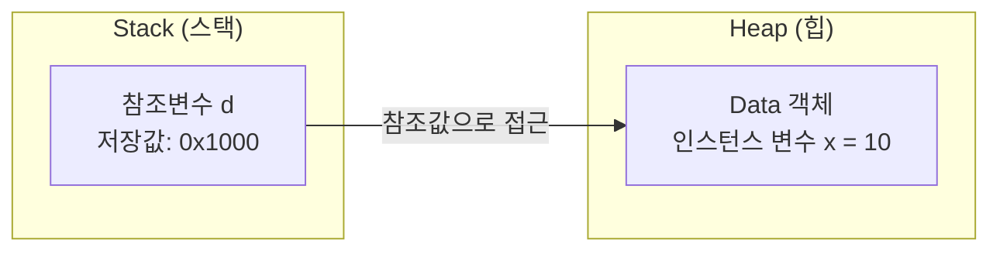
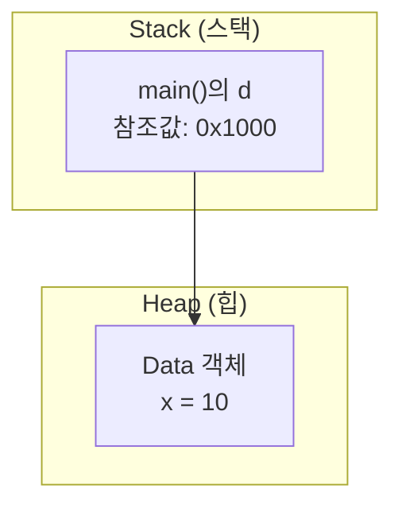
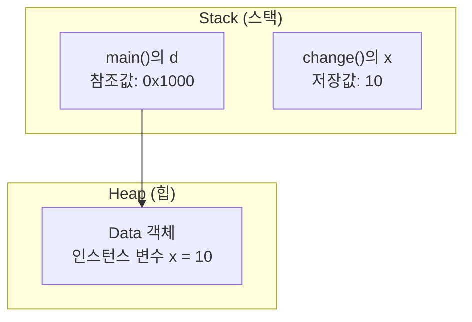
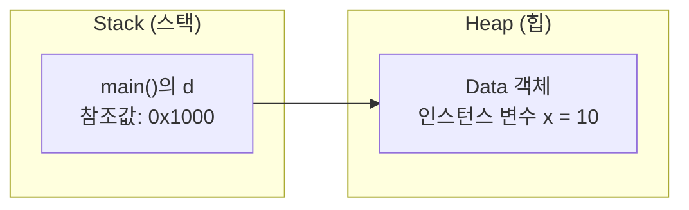
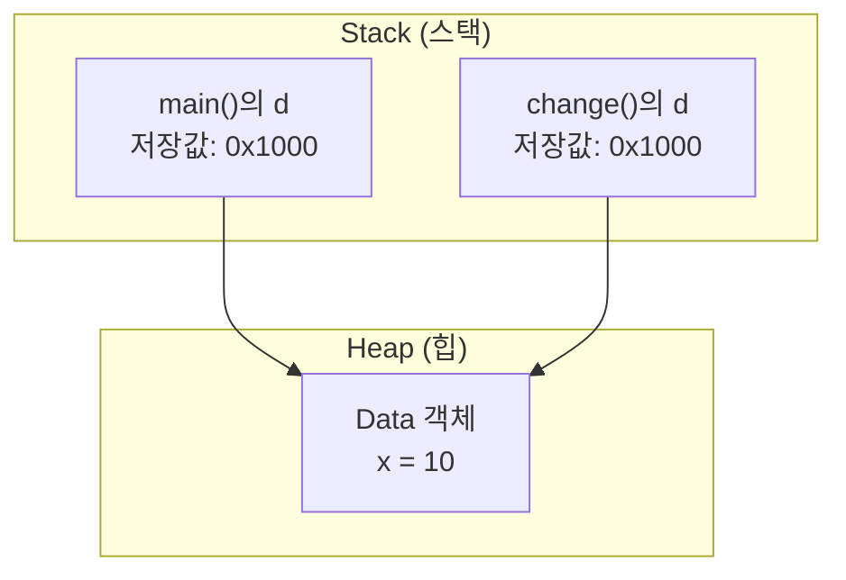
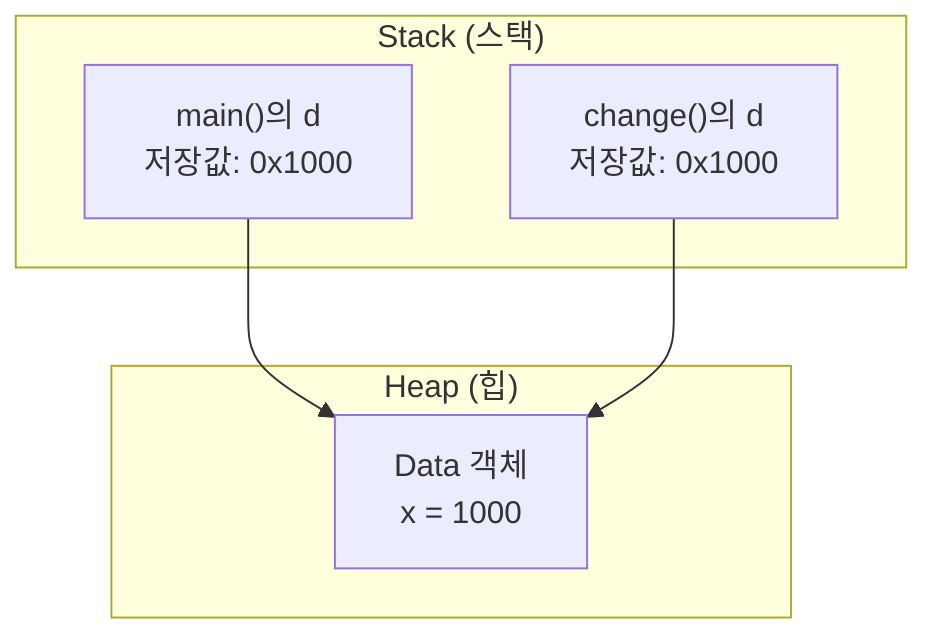

# 자바 기본형 매개변수 (Primitive Parameter)

## 1. 예제 코드

```java
class Data {
    int x;
}

public class PrimitiveParamEx01 {
    public static void main(String[] args) {
        Data d = new Data();
        d.x = 10;

        System.out.println("main() : x = " + d.x);

        change(d.x);

        System.out.println("After change(d.x)");
        System.out.println("main() : x = " + d.x);
    }

    static void change(int x) {
        x = 1000;
        System.out.println("change(): x = " + x);
    }
}
```

## 2. 실행 결과

```text
main() : x = 10
change(): x = 1000
After change(d.x)
main() : x = 10
```

## 3. 객체 생성과 메모리 구조

```java
Data d = new Data();
d.x = 10;
```

### ① 객체 생성

`new Data()`를 실행하면 `Data` 객체가 생성된다.

이해를 위해 객체의 참조값을 `0x1000`이라고 가정한다.



- `d`: 객체 자체가 아니라 객체를 참조하는 값을 저장하는 변수
- `0x1000`: 설명을 위해 가정한 참조값
- `x = 10`: 객체 내부에 저장된 인스턴스 변수의 값

**중요:** `d`에 저장된 값은 `10`이 아니라 객체를 참조하는 값이다. `10`은 객체 내부의 `x`에 저장되어 있다.

## 4. 기본형 매개변수 전달

```java
change(d.x);
```

### ① 메서드 호출 직전

`d.x`를 읽으면 정수값 `10`을 얻는다.



메서드 호출 시 전달하는 것은 `d`의 참조값 `0x1000`이 아니라 **`d.x`에 저장된 정수값 `10`**이다.

### ② 매개변수에 값 복사

```java
static void change(int x) {
    x = 1000;
}
```

`change(d.x)`를 호출하면 매개변수 `x`가 생성되고, 전달받은 정수값 `10`이 복사된다.



이때 서로 다른 두 변수에 값이 존재한다.

| 변수 | 저장된 값 | 위치 |
|---|---:|---|
| `main()`의 `d` | `0x1000` | 스택 |
| 객체의 `x` | `10` | 힙의 객체 내부 |
| `change()`의 `x` | `10` | 스택 |

여기서 `change()`의 `x`와 객체의 `x`는 이름만 비슷할 뿐, 서로 다른 변수다.

### ③ `x = 1000` 실행

```java
x = 1000;
```

매개변수 `x`에 새로운 정수값을 대입한다.


변경 결과는 다음과 같다.

- `change()`의 지역 변수 `x`: `10` → `1000`
- 객체의 인스턴스 변수 `d.x`: `10` 그대로 유지

매개변수 `x`에 복사된 값만 변경했으므로 원래 객체 내부의 값에는 영향을 주지 않는다.

### ④ 메서드 종료

`change()`가 종료되면 해당 메서드의 스택 프레임과 지역 변수 `x`는 더 이상 유효하지 않다.



이후 `main()`에서 `d.x`를 출력하면 여전히 `10`이 나온다.

## 5. 참조형 매개변수와 비교

앞서 배운 다음 코드와 비교하면 차이가 명확해진다.

```java
change(d);
```

이 경우에는 객체의 참조값이 매개변수에 복사된다.

설명을 위해 참조값을 `0x1000`이라고 가정하면 다음과 같다.



두 변수는 각각 참조값을 저장하지만, 그 값이 같으므로 같은 객체에 접근할 수 있다.

따라서 다음 코드에서는 객체 내부의 값이 변경된다.

```java
static void change(Data d) {
    d.x = 1000;
}
```



두 참조 변수가 같은 객체를 가리키므로, `change()`에서 수정한 필드 값을 `main()`에서도 확인할 수 있다.

## 6. 핵심 정리

- 기본형 매개변수: 실제 데이터값이 복사된다.
- 참조형 매개변수: 객체의 참조값이 복사된다.
- `d`는 참조값을 저장하고, `d.x`는 객체 내부의 정수값을 나타낸다.
- 기본형 매개변수의 값을 변경해도 원래 변수는 바뀌지 않는다.
- 참조형 매개변수로 같은 객체의 필드를 변경하면 원래 객체에도 변경 사항이 반영된다.

**핵심: 자바는 항상 값을 복사해서 전달한다. 달라지는 것은 복사되는 값이 실제 데이터인지, 객체의 참조값인지다.**
