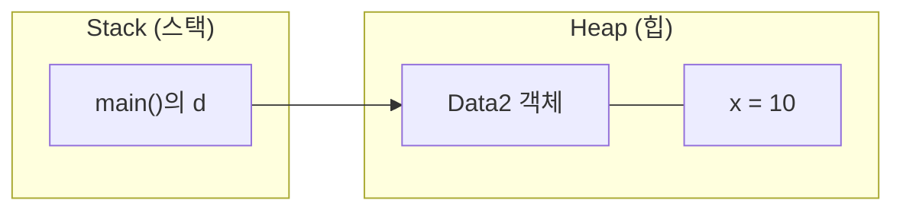
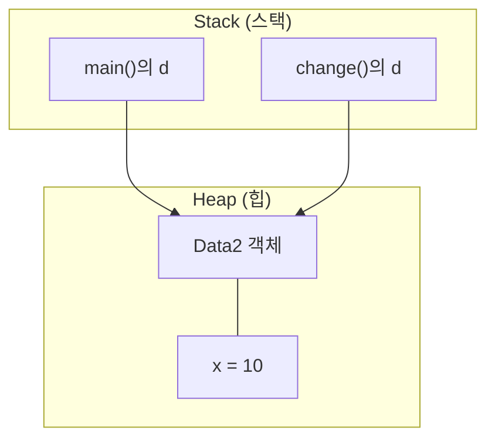
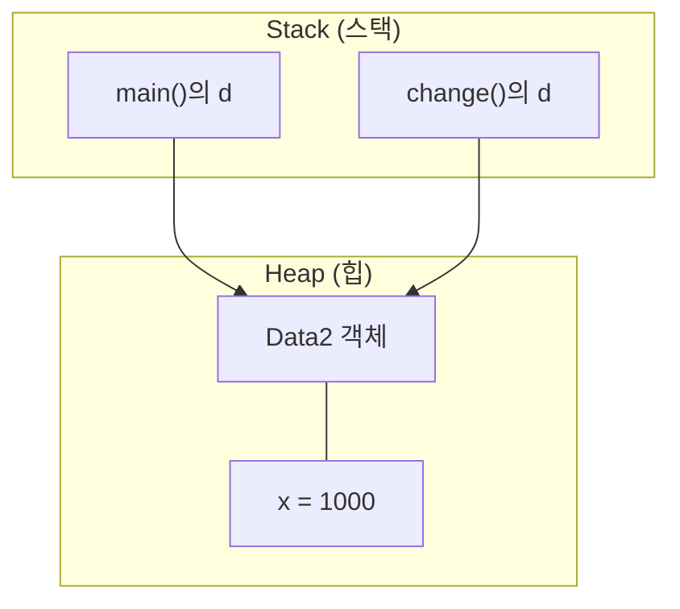
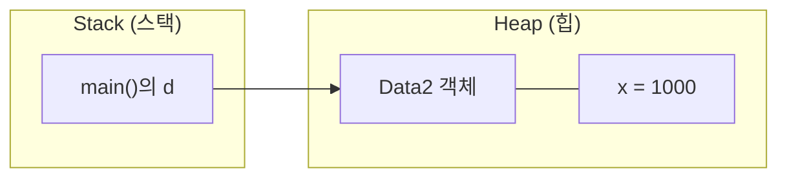
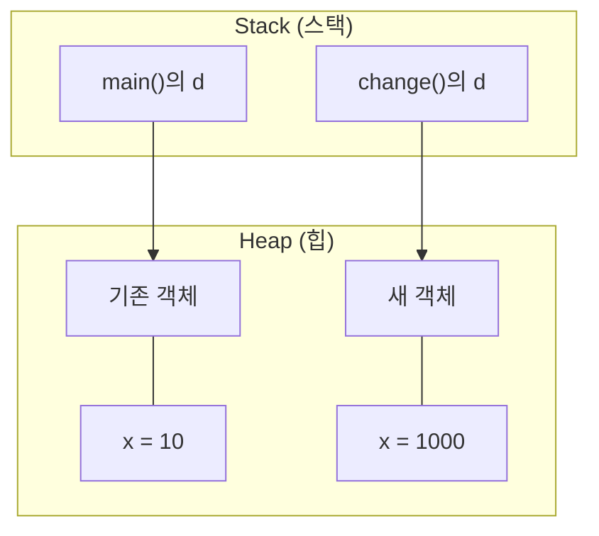

# 자바 참조형 매개변수 (Reference Parameter)

## 1. 예제 코드

```java
class Data2 {
    int x;
}

class PrimitiveParamEx02 {
    public static void main(String[] args) {
        Data2 d = new Data2();
        d.x = 10;
        System.out.println("main(): x = " + d.x);

        change(d);
        System.out.println("After change(d)");
        System.out.println("main(): x = " + d.x);
    }

    static void change(Data2 d) {
        d.x = 1000;
        System.out.println("change(): x = " + d.x);
    }
}
```

## 2. 실행 결과

```text
main(): x = 10
change(): x = 1000
After change(d)
main(): x = 1000
```

## 3. 객체 생성

`Data2 d = new Data2();`를 실행하면 `Data2` 객체가 생성되고, 참조 변수 `d`가 해당 객체를 가리킨다.



- `d`: 객체의 참조값을 저장하는 지역 변수
- `new Data2()`: 새로운 객체 생성
- `x`: 객체 내부에 존재하는 인스턴스 변수

## 4. 참조값 전달

`change(d);`를 호출하면 `main()`의 참조값이 `change()`의 매개변수 `d`에 복사된다.



두 변수는 서로 다른 변수지만, 같은 객체를 참조한다.

## 5. 객체의 필드 변경

`change()` 내부에서 다음 코드를 실행한다.

```java
d.x = 1000;
```

객체 자체의 인스턴스 변수 `x`가 변경된다.



`main()`의 `d`와 `change()`의 `d`가 같은 객체를 참조하므로, `main()`에서도 변경된 값 `1000`을 확인할 수 있다.

## 6. 메서드 종료

`change()`가 종료되면 해당 메서드의 지역 변수인 매개변수 `d`는 더 이상 사용할 수 없다. 하지만 `main()`의 `d`는 그대로 남아 객체를 참조한다.



따라서 메서드가 종료되어도 객체의 `x` 값은 `1000`으로 유지된다.

## 7. 새로운 객체를 대입하면?

이번에는 `change()`에서 새로운 객체를 생성해 매개변수 `d`에 대입한다고 가정한다.

```java
static void change(Data2 d) {
    d = new Data2();
    d.x = 1000;
}
```



이 경우 `change()`의 `d`만 새로운 객체를 참조한다. `main()`의 `d`는 기존 객체를 계속 참조하므로 원래 객체의 `x` 값은 `10`이다.

## 8. 핵심 개념 정리

- 자바는 매개변수를 항상 값으로 전달한다.
- 객체를 전달할 때는 객체의 참조값이 복사된다.
- 참조값이 복사되면 두 변수가 같은 객체를 참조할 수 있다.
- 같은 객체의 필드를 변경하면 호출한 메서드에서도 변경된 값을 확인할 수 있다.
- 매개변수에 새로운 객체를 대입해도 호출한 쪽의 참조 변수는 바뀌지 않는다.

**핵심: 참조값은 복사되지만, 두 참조 변수가 같은 객체를 가리킬 수 있다.**
