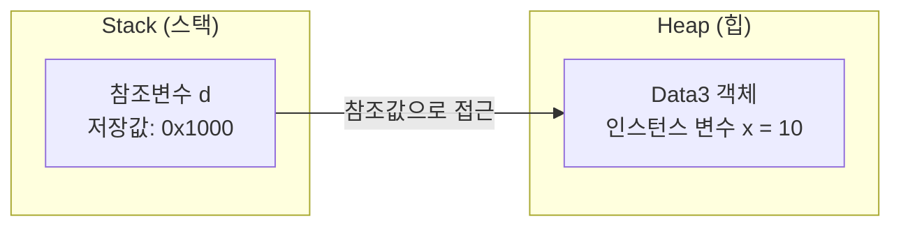
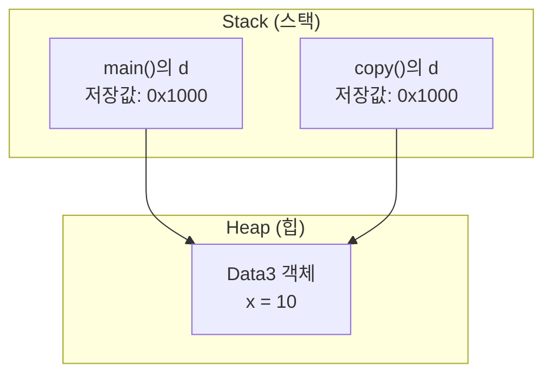
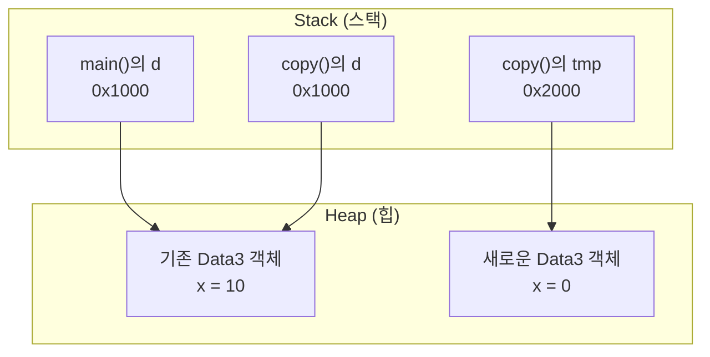
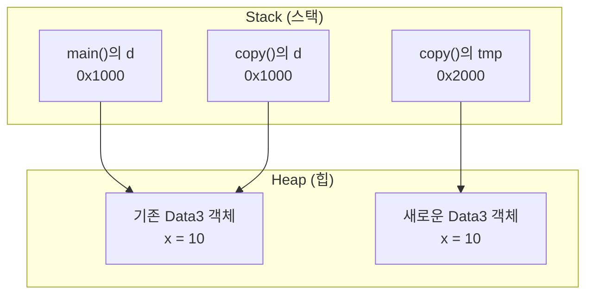
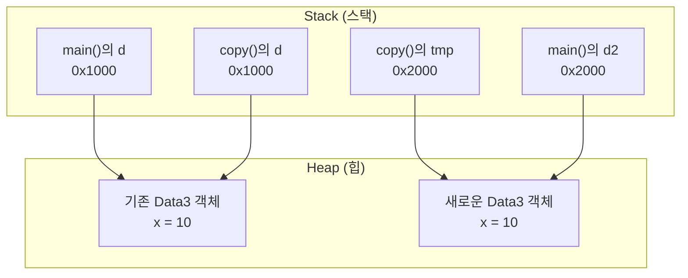
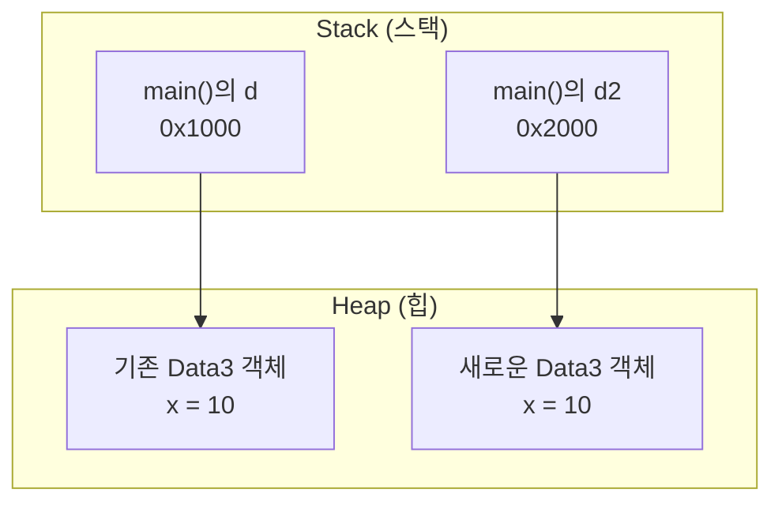

# 자바 참조형 반환 (Reference Return)

## 1. 예제 코드

```java
class Data3 {
    int x;
}

// 참조형의 반환 : 주소를 반환
class ReferenceReturnEx {
    public static void main(String[] args) {
        Data3 d = new Data3();
        d.x = 10;

        Data3 d2 = copy(d);
        System.out.println("d.x = " + d.x);
        System.out.println("d2.x = " + d2.x);
    }

    static Data3 copy(Data3 d) {
        Data3 tmp = new Data3();
        tmp.x = d.x;

        return tmp;
    }
}
```

## 2. 실행 결과

```text
d.x = 10
d2.x = 10
```

## 3. 객체 생성과 메모리 구조

```java
Data3 d = new Data3();
d.x = 10;
```

### ① 객체 생성

`new Data3()`를 실행하면 새로운 `Data3` 객체가 생성된다.

이해를 위해 참조값을 `0x1000`이라고 가정한다.



- `d`: 객체 자체가 아니라 객체의 참조값을 저장하는 변수
- `0x1000`: 설명을 위해 가정한 참조값
- `x = 10`: 객체 내부에 저장된 인스턴스 변수의 값

**중요:** `d`에는 `10`이 저장된 것이 아니라 객체를 참조하는 값이 저장되어 있다.

## 4. 참조형 반환 과정

```java
Data3 d2 = copy(d);
```

### ① 메서드 호출

`copy(d)`를 호출하면 `main()`의 참조변수 `d`에 저장된 참조값이 매개변수 `d`에 복사된다.

```java
static Data3 copy(Data3 d) {
    Data3 tmp = new Data3();
    tmp.x = d.x;

    return tmp;
}
```

이때 메서드 내부의 `d`와 `main()`의 `d`는 서로 다른 변수지만 같은 객체를 참조한다.



### ② 새로운 객체 생성

```java
Data3 tmp = new Data3();
```

`new Data3()`를 실행하면 기존 객체와 별개의 새로운 객체가 생성된다.

새로운 객체의 참조값을 `0x2000`이라고 가정한다.



이 시점에서 객체는 총 2개다.

- 기존 객체: `d`와 `copy()`의 `d`가 참조
- 새로운 객체: `tmp`가 참조

### ③ 기존 객체의 값 복사

```java
tmp.x = d.x;
```

기존 객체의 `x`에 저장된 `10`을 읽어서 새로운 객체의 `x`에 대입한다.



여기서 중요한 점은 **객체 자체를 복사한 것이 아니라 객체 내부의 변수 `x`에 저장된 값 `10`을 복사했다는 것**이다.

따라서 두 객체는 서로 독립적이다.

### ④ 참조값 반환

```java
return tmp;
```

`return tmp`는 `tmp`가 저장하고 있는 참조값 `0x2000`을 반환한다.

즉, 객체 자체를 반환하는 것이 아니라 객체를 참조할 수 있는 값을 반환한다.



`d2`는 반환받은 참조값 `0x2000`을 저장한다.

따라서 `d2`는 새롭게 생성된 객체를 참조하게 된다.

### ⑤ 메서드 종료

`copy()`가 종료되면 메서드 내부의 지역변수 `d`, `tmp`는 더 이상 사용할 수 없다.

하지만 `tmp`가 참조하던 객체는 사라지지 않는다.

왜냐하면 `main()`의 `d2`가 해당 객체를 참조하고 있기 때문이다.



## 5. 참조형 반환의 특징

| 구분 | 참조값 |
|---|---|
| `d` | `0x1000` |
| `copy()`의 `d` | `0x1000` |
| `tmp` | `0x2000` |
| `d2` | `0x2000` |

- `d`와 `copy()`의 `d`는 같은 객체를 참조한다.
- `tmp`는 새로운 객체를 참조한다.
- `return tmp`는 새로운 객체의 참조값을 반환한다.
- `d2`는 반환받은 참조값을 저장한다.

**주의:** 참조형 반환이라고 해서 기존 객체의 참조값을 무조건 반환하는 것은 아니다. 어떤 참조변수를 `return`하느냐에 따라 반환되는 참조값이 달라진다.

## 6. 핵심 정리

- 참조형 반환: 객체의 참조값을 반환한다.
- `new Data3()`: 새로운 객체를 생성한다.
- `tmp.x = d.x`: 기존 객체의 인스턴스 변수 값을 새로운 객체에 복사한다.
- `return tmp`: `tmp`에 저장된 참조값을 반환한다.
- `Data3 d2 = copy(d)`: 반환받은 참조값을 `d2`에 저장한다.
- 메서드가 종료되어도 반환된 객체를 다른 참조변수가 참조하고 있다면 객체는 유지된다.

**핵심: 참조형 반환은 메서드에서 생성하거나 전달받은 객체의 참조값을 반환하여, 메서드 외부에서도 해당 객체에 접근할 수 있도록 하는 것이다.**